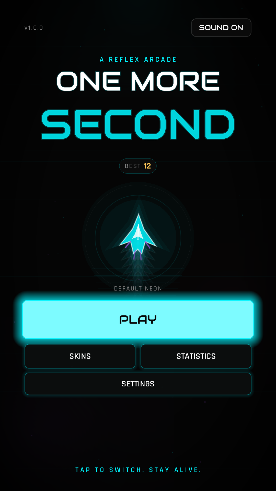
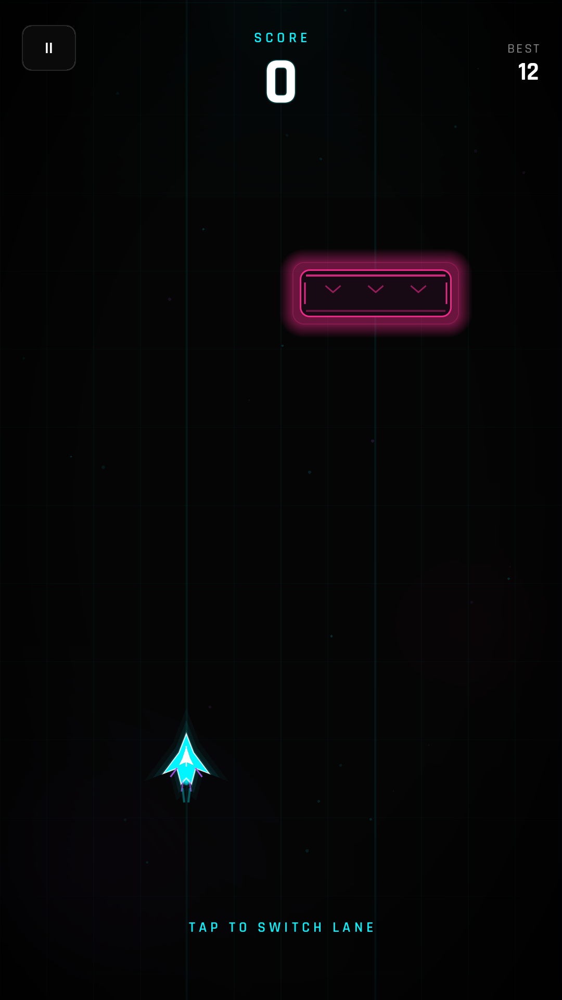
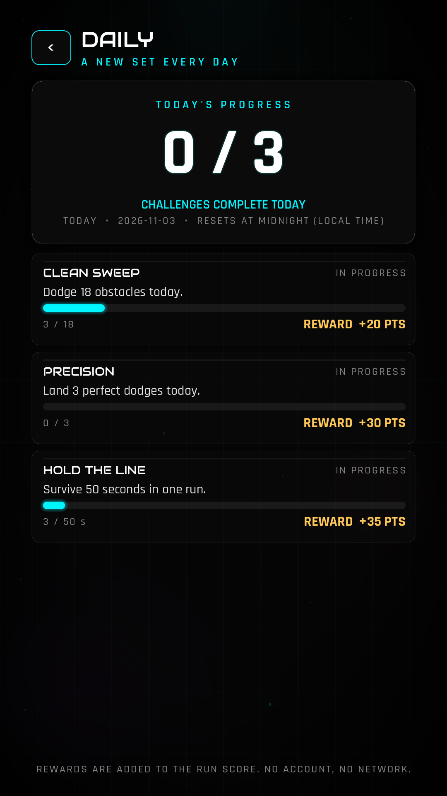
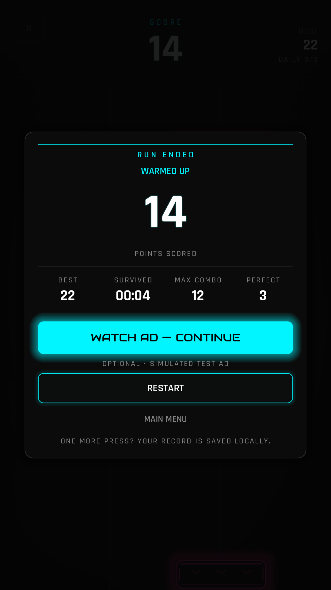
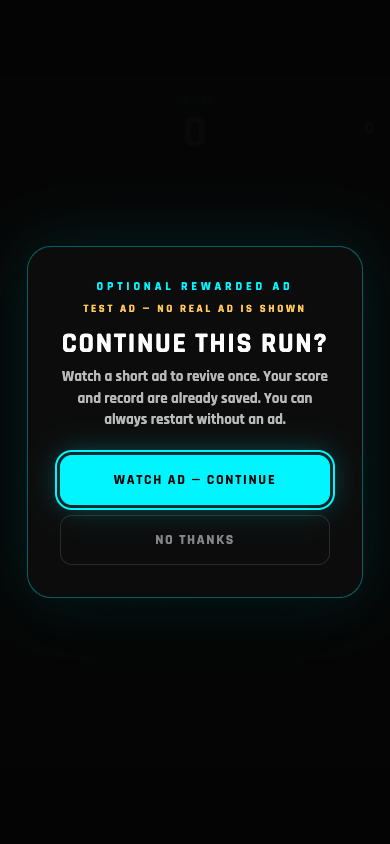

# ONE MORE SECOND

**A minimalist neon reflex arcade game. Two lanes. One tap. Stay alive.**

<p align="center">
  
  
  
  
</p>

ONE MORE SECOND is a portrait endless runner built in **Godot 4.7.2** with GDScript.
You sit in one of two neon lanes while hazards fall from above; tap (or press a key) to
switch lanes, survive as long as possible, and chase a personal best.

The project is designed as a commercially extensible foundation: a finished, polished
core game with local saves, skins, settings, statistics, platform layers, a local-first
analytics facade, and deliberately inactive monetization hooks.

---

## Contents

- [Feature overview](#feature-overview)
- [Screens](#screens)
- [Quick start](#quick-start)
- [Controls](#controls)
- [Project structure](#project-structure)
- [Building and deploying](#building-and-deploying)
- [Monetization status](#monetization-status)
- [Privacy](#privacy)
- [Testing and verification](#testing-and-verification)
- [Known limitations](#known-limitations)
- [Documentation](#documentation)
- [Credits and licensing](#credits-and-licensing)

---

## Feature overview

### Core game
- Two-lane, one-input reflex gameplay with forgiving hitboxes.
- **Combo multiplier** at 5/10/20/30 dodges (×1–×5), with a live HUD combo bar,
  milestone flashes and reset-on-collision.
- **Perfect Dodge** skill mechanic: narrowly switching away from an obstacle within a
  configurable 100–280 ms impact window awards +2 points, confirmed only after the
  obstacle actually passes. One reward per obstacle, never for an unsafe switch.
- Pattern-based obstacle generator with six patterns (single, stagger, zigzag,
  late switch, rush, gauntlet), seeded randomness, repeat damping and a
  five-minute-proven fairness envelope.
- Four recovery sections during a long run, plus a subtle spawn-cadence wave, so the
  pressure curve has texture instead of a flat ramp.
- Score per obstacle scaled by combo, live HUD, personal best, run rank and survival
  time.
- **Local daily challenges**: three date-seeded challenges per day (dodges, perfect
  dodges, plus combo/score/survival), cumulative progress, score rewards and a
  dedicated Daily screen. No account or network.
- Screen shake, hit flashes, particles, tapered ship trail, lane sparks, perfect
  rings and challenge toasts. Screen shake follows the REDUCE EFFECTS setting.
- Pause/resume, restart, menu transition, auto-save.
- Frame-rate independent movement; designed for 60 FPS and low-end devices.
- Reduced-effects mode for weaker hardware or motion sensitivity.

### Meta
- Polished main menu with animated vector ship preview of the equipped skin.
- Five free skins (Default Neon, Cyan, Violet Shift, Hot Signal, Gold Rush).
- Three premium skins prepared but **not purchasable** in v1.
- Local statistics: best score, runs, total score, best/total play time, obstacles
  avoided, best combo, perfect dodges, revives, average score, highest rank.
- Settings: SFX, music, master volume, vibration (mobile), reduced effects, fullscreen
  (web/desktop), local analytics, reset progress.
- Local JSON save with backup rotation and corruption recovery.
- Provider-agnostic rewarded-ad system for the revive loop: a mock provider in
  development and a Google AdSense H5 Games Ads bridge prepared for web.
  Production web ads are **disabled by default** until the owner supplies approval,
  publisher ID, CMP consent and hosting configuration.
- Optional interstitials at run transitions, frequency-capped and disabled by default;
  no banners.
- Privacy-first local analytics (JSONL) with an on/off setting; the default build makes
  no ad network requests.

### Platforms
- **Web/HTML5**: Godot Web export, custom responsive HTML shell, mobile touch and
  keyboard, fullscreen support, GitHub Pages and itch.io packaging documented.
  Isolated AdSense H5 Games Ads bridge, DOM reward prompt and consent/config gate;
  live production ads remain disabled pending Google approval and owner IDs.
- **Android**: configured portrait export preset, adaptive icons, immersive mode,
  APK/AAB workflow documented.
- **iOS**: configured portrait export preset, icon set, Xcode/App Store workflow
  documented. Signing and on-device verification require the owner's Apple account.

### Engineering
- Typed GDScript, central palette/design system, reusable theme generated from code.
- No paid or third-party game assets. Fonts are OFL; all art and audio are generated
  procedurally by scripts in `tools/`.
- Headless integration tests, pure scoring/challenge tests, ad lifecycle/policy tests
  and a five-minute spawner fairness stress test.
- CI workflow that builds and deploys the web version to GitHub Pages.

---

## Screens

| Gameplay | Daily challenges |
| --- | --- |
|  |  |

| Menu | Game over |
| --- | --- |
|  |  |

Game over includes a reward loop only where a rewarded ad provider is available.
The default web build ships without ads. The prepared H5 reward prompt is shown only
after production approval, publisher ID and consent are configured.

---

## Quick start

### Requirements
- **Godot 4.7.2** (standard build, not .NET).
- macOS, Windows or Linux for development.
- Optional: Android SDK/JDK and Xcode for mobile exports.

### Run the game
1. Open Godot, choose **Import**, and select `project.godot` from this folder.
2. Let the editor import assets (a few seconds).
3. Press **F5** (Run Project).

The project boots into the main menu. Saves and analytics are written under Godot's
`user://` directory, not inside the repository.

Command line:

```bash
godot --path . --editor   # open in editor
godot --path .            # run
```

### First verification pass

```bash
godot --headless --path . --import
godot --headless --path . res://tests/GameplayTest.tscn
godot --headless --path . res://tests/ScoringTest.tscn
godot --headless --path . res://tests/ChallengeTest.tscn
godot --headless --path . res://tests/AdsTest.tscn
godot --headless --path . res://tests/SpawnerStress.tscn
```

All tests print `PASS (0 failures)` and exit non-zero on failure.

### Build the web version

Install the matching **Web export templates** in Godot, then:

```bash
./tools/build_web.sh
python3 -m http.server 8080 --directory exports/web
# open http://localhost:8080
```

`exports/web/` is ready for any static host. `exports/one-more-second-web.zip` is
ready to upload to itch.io (HTML game, `index.html` at the ZIP root).

See [docs/web-deployment.md](docs/web-deployment.md) for hosting, compression,
GitHub Pages and itch.io details.

---

## Controls

| Action | Touch | Keyboard |
| --- | --- | --- |
| Switch lane | Tap anywhere | `Space`, `W`, `↑`, `A`, `D`, `←`, `→` |
| Pause / resume | Pause button | `Esc`, `P` |
| Menu navigation | Tap | Arrow keys / Tab + Enter |

On mobile, tapping UI buttons does not switch lanes; only taps on the playfield do.

---

## Project structure

```text
one_more_second/
├── project.godot              # Godot 4.7 project configuration
├── export_presets.cfg         # Web / Android / iOS presets
├── scenes/
│   ├── main/                  # App shell
│   ├── menu/
│   ├── gameplay/              # Gameplay, HUD, pause
│   ├── player/
│   ├── obstacles/
│   ├── game_over/
│   ├── settings/
│   ├── skins/
│   ├── stats/
│   ├── challenges/            # Local daily challenges
│   └── components/            # Reusable toggle, test ad overlay
├── scripts/
│   ├── core/                  # Palette, config, difficulty, router, app shell
│   ├── gameplay/              # Player, trail, obstacle, spawner, FX, state machine
│   └── ui/                    # Screens, shared widgets, ship renderer
├── systems/
│   ├── save/
│   ├── audio/
│   ├── skins/
│   ├── ads/                   # Provider contract, policy, test placement
│   ├── analytics/
│   ├── monetization/
│   └── platform/
├── assets/
│   ├── fonts/                 # Audiowide + Rajdhani (OFL, licenses included)
│   ├── icons/                 # Generated vector + PNG export sizes
│   ├── textures/              # Generated splash
│   ├── sounds/                # Generated SFX
│   ├── music/                 # Generated synthwave loop
│   └── theme/                 # Generated UI theme
├── tools/                     # Reproducible theme/icon/audio generators + build script
├── tests/                     # Headless integration + stress tests, visual harness
├── web/shell.html             # Custom web loading shell
├── docs/                      # Architecture, platform builds, monetization, QA
├── .github/workflows/         # GitHub Pages deployment
├── BUILDING.md                # Platform build quick reference
├── CHANGELOG.md
├── THIRD_PARTY_NOTICES.md
└── LICENSE
```

---

## Building and deploying

- **Web / itch.io / GitHub Pages:** [docs/web-deployment.md](docs/web-deployment.md)
- **Android APK and AAB:** [docs/android-build.md](docs/android-build.md)
- **iOS and Xcode:** [docs/ios-build.md](docs/ios-build.md)
- **All platforms, short version:** [BUILDING.md](BUILDING.md)
- **GitHub Actions:** `.github/workflows/deploy-web.yml` builds and publishes the web
  game to GitHub Pages on every push to `main`/`master` (or manually).

Version 1.2.0 uses Godot **4.7.2**. Export templates must match the editor version
exactly. The project uses the **Compatibility** renderer for broad web/mobile support.

---

## Monetization status

The base game is free and fully playable offline.

- Rewarded revive is implemented behind a provider abstraction. In debug desktop/native
  builds a clearly-labelled **SIMULATED TEST AD** remains available; it is never used
  in release or on web.
- Web integration: **Google AdSense H5 Games Ads** (official Ad Placement API) is
  wired through an isolated JavaScript bridge. The reward prompt is a styled DOM
  dialog whose button calls the provider's `showAdFn()` directly, preserving the
  required user gesture.
- **Production web ads are disabled by default** in two places:
  `AdConfig.PRODUCTION_ADS_ENABLED = false` and `web/ads-config.js` `enabled: false`.
  With defaults, no Google script or request is made.
- Enabling requires an approved AdSense H5 Games Ads account, an approved domain,
  HTTPS, a publisher ID and a Google-certified CMP for EEA/UK consent. Those are
  owner/external steps documented in [docs/monetization.md](docs/monetization.md).
- Interstitial policy and provider hooks exist but are disabled by default. Banner
  code is intentionally not displayed.
- The store abstraction lists planned products and prices; **no purchase flow is
  active** and no fake transaction is exposed.
- AdMob test IDs are included only as documentation constants. A native adapter
  interface is prepared, but no native AdMob plugin is bundled or tested.

<p align="center">
  
</p>

*The web reward prompt in test mode. The "TEST AD" label is hidden for production;
production remains disabled until owner approval.*

Optional support for the developer is prepared: set `GameConfig.SUPPORT_URL` in
`scripts/core/game_config.gd` to a real page (itch.io, Ko-fi, etc.). While the string
is empty, the button is hidden.

---

## Privacy

- No location, contacts, advertising identifiers or personal data are collected.
- Analytics v1 is **local only**: JSONL files under `user://analytics/`, capped and
  rotated, controllable in Settings.
- The default build makes no ad network requests. If production web ads are enabled,
  Google's AdSense/Ad Placement script becomes a third-party network participant;
  the owner must integrate a certified CMP, update this policy and complete store
  disclosures before release.
- The ad bridge does not send save data, scores, names or other personal data to the
  provider; only standard provider configuration/callbacks are used.
- Saves remain on the device (IndexedDB for web, app data for Android/iOS).

See [docs/privacy.md](docs/privacy.md).

---

## Testing and verification

Verified in this build:

- Godot 4.7.2 project import with zero parse errors.
- Headless gameplay integration test (61 assertions): boot, input, exact combo
  multipliers, one-per-obstacle perfect dodges, collision/reset, restart,
  pause/resume, challenge reward and duplicate guard, immediate game-over save,
  provisional-record rollback on revive, one-revive-per-run, save round-trip and
  analytics.
- Pure scoring/difficulty/daily-catalog test (57 assertions) and challenge
  persistence/rollover test (14 assertions).
- Ads lifecycle/policy test (46 assertions): provider unavailable, load/display
  failure, ready/close timeout, duplicate reward callbacks, dismissed ad, one reward,
  interstitial policy/impression counting and save restoration.
- Headless five-minute spawner stress test (14 assertions): 470 obstacles, six
  patterns, four recovery sections, bounded active set, zero unreactable two-lane
  overlaps, scripted safe-lane bot survives.
- Native visual review of every screen at 1080×1920, including combo HUD, challenge
  screen, rewarded game-over state and challenge toast.
- Web export loaded from a local HTTP server in headless Chrome (WebGL2): menu,
  mouse/touch/keyboard input, Play, pause, no console/page errors.
- Default web build verified ad-free: bridge reports `ads_disabled`, zero Google ad
  requests, no AdSense script and no reward prompt.
- Web H5 integration verified against a mocked implementation of the official
  Ad Placement API contract: DOM prompt → watch click → provider shown/reward/close
  → one revive, with no console errors. **Not** live Google fill/approval.
- Mobile browser emulation (390×844, touch): portrait layout, touch PLAY, single-tap
  lane switch, touch pause, no console errors.
- Android 1.2.0 debug APK installed on an Android 15 ARM64 emulator: boot, portrait
  menu, touch lane switch, game over, immediate save, cold-relaunch best score,
  Home/resume lifecycle, no crash or script errors. **No physical phone was attached.**

Not verified (requires owner accounts/hardware):

- Android APK/AAB compilation and on-device run (Android SDK not installed here).
- iOS export, signing, Xcode build and device/App Store run (no Apple account/team).
- Live AdSense H5 approval/fill/domain whitelisting and a real CMP; the bridge itself
  was tested with a mocked Ad Placement API contract.
- Native AdMob serving, plugin installation and real in-app purchases.
- Low-end physical phones, Safari/Firefox/Edge on physical devices.

Exact test matrix and evidence: [docs/testing.md](docs/testing.md).

---

## Known limitations

- Godot Web exports are relatively large: the wasm file is ~38 MB uncompressed,
  ~10 MB gzip. Enable compression on the host; see the deployment guide.
- The project is portrait-first and uses a 1080×1920 design canvas with letterboxing
  on unusual aspect ratios.
- Web audio starts after the first user interaction (browser policy).
- The shipped web build is ad-free by default. Enabling live ads requires owner
  approval, IDs, CMP consent and hosting verification; the mock ad is debug-only.
- The native AdMob adapter is a prepared fail-closed interface; no native plugin is
  bundled or tested.
- Combo scoring changes the score scale (old records remain valid but are easier to
  beat); this is intentional since 1.1.0.
- Daily challenge progress is stored locally per date; changing device time or
  clearing site/app data changes the local set/progress.
- Cloud saves, global leaderboards and daily challenges are future work; the
  architecture leaves room for them but no backend exists.

---

## Documentation

| Document | Purpose |
| --- | --- |
| [BUILDING.md](BUILDING.md) | Quick platform build commands |
| [docs/architecture.md](docs/architecture.md) | Systems, state machines, save schema, extension points |
| [docs/development.md](docs/development.md) | Local workflow, tests, asset regeneration, conventions |
| [docs/web-deployment.md](docs/web-deployment.md) | Own site, GitHub Pages, itch.io, caching/compression |
| [docs/android-build.md](docs/android-build.md) | SDK setup, APK/AAB, signing, store checklist |
| [docs/ios-build.md](docs/ios-build.md) | Xcode, signing, App Store notes |
| [docs/monetization.md](docs/monetization.md) | Ads abstraction, IAP plan, consent, activation steps |
| [docs/privacy.md](docs/privacy.md) | Data practices for stores and players |
| [docs/testing.md](docs/testing.md) | Verification matrix and manual QA |
| [docs/troubleshooting.md](docs/troubleshooting.md) | Common failures and fixes |
| [docs/release-checklist.md](docs/release-checklist.md) | Final go-live audit |

---

## Credits and licensing

- **Design, code, generated art and generated audio:** © 2026 ONE MORE SECOND.
  All rights reserved; see [LICENSE](LICENSE).
- **Audiowide** by Brian J. Bonislawsky / Astigmatic (OFL 1.1).
- **Rajdhani** by Indian Type Foundry (OFL 1.1).
- Full font licenses: `assets/fonts/LICENSE-*.txt`;
  see [THIRD_PARTY_NOTICES.md](THIRD_PARTY_NOTICES.md).
- No third-party samples, paid asset packs, copyrighted music or trademarks are used.

The repository is **private/proprietary by default**. Viewing or forking it on GitHub
does not grant commercial rights. The bundled fonts remain available under the OFL.

---

## One more press?

The game is built to make the player think *“one more try.”*
If you extend it, keep the loop fast, the input honest, and the ads optional.
