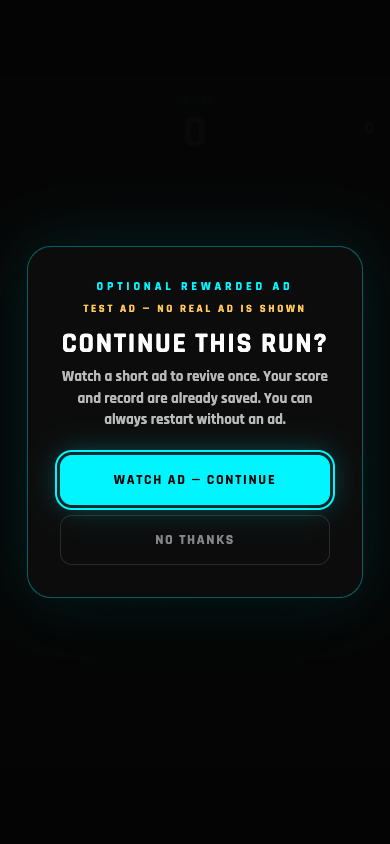

# Monetization

## 1. Current state (v1.2.0)

The game is free, complete and playable without ads, purchases or an account.

| Area | State |
| --- | --- |
| Web provider | **Google AdSense H5 Games Ads adapter implemented and wired**, production **disabled by default** |
| Web live ads | **Not enabled / not tested with a live Google account** |
| Rewarded revive | Provider-confirmed optional revive; mock provider for development |
| Interstitial | Manager policy, provider hooks and gameplay restart flow implemented; disabled by default |
| Banners | Interface only; intentionally not used |
| Native AdMob | Interface/stub prepared; **no plugin bundled and no native build test** |
| IAP | Catalog + inactive abstraction; no purchase flow |
| Support link | Prepared; hidden until configured |

The current web release is **ad-free** because both safety switches are off:

1. `AdConfig.PRODUCTION_ADS_ENABLED = false` in
   `systems/ads/ad_config.gd`.
2. `enabled: false` in `web/ads-config.js`.

Google AdSense H5 Games Ads is a **by-application program**. Account approval is
not guaranteed, requires an approved AdSense account, and typically requires
domain-level approval/verification. The integration is complete enough for the
owner to configure, but live serving has **not** been validated.

---

## 2. Architecture

```
Gameplay / GameOver
        │
   AdsManager (policy, timeouts, one reward per attempt, analytics)
        │
   AdProvider contract
   ├── MockAdProvider          development desktop/native debug only
   ├── WebH5AdProvider         Google AdSense H5 Games Ads bridge
   ├── NativeAdMobProvider     prepared fail-closed stub (no plugin bundled)
   └── UnavailableAdProvider   explicit "no provider" result
        │
   web/ads-bridge.js           only place that knows Google's Ad Placement API
   web/ads-config.js           public, non-secret web configuration
```

The game never calls Google directly. The web bridge uses the official
`adBreak()` / `adConfig()` Ad Placement API.

### Rewarded lifecycle

1. Game over → `AdsManager.prepare_rewarded_ad()`.
2. Web: bridge calls `adBreak({type: "reward", beforeReward: ..., ...})`.
3. The Ad Placement API calls `beforeReward(showAdFn)` **only if a rewarded ad is
   actually offered**. The bridge then shows a styled DOM prompt with
   **WATCH AD — CONTINUE** and **NO THANKS**.
4. The DOM button calls `showAdFn()` directly from the browser click, preserving
   the required user gesture. (Calling it later from a Godot frame is not reliable
   for browser user-activation requirements.)
5. Provider callbacks: `beforeAd` → shown; `adViewed` → reward earned;
   `adDismissed` → no reward; `afterAd` → closed.
6. `AdsManager` grants **only after** a reward-earned callback and the close, and
   only once per attempt. A duplicate `reward_earned` cannot add a second revive.
7. Gameplay's one-revive-per-run rule is the final guard.

A fatal or late switch never produces an ad reward. Cancelling the prompt, a load
failure, no fill, a close timeout and a display failure all leave the normal
restart/menu path intact.

<p align="center">
  
</p>

*The web reward prompt in test mode. The TEST AD label is only visible in test mode;
production is disabled until owner approval.*

### Interstitial lifecycle

- Frequency policy: enabled switch + at least 3 completed runs + 150 seconds since
  the last interstitial + no rewarded/prompt flow in progress.
- Requested only from an explicit **Restart** action on the game-over screen.
- Never during active gameplay, pause, a reward prompt or an ad.
- If no ad is available/fails/times out, the next run starts anyway.
- **Disabled by default** (`AdConfig.INTERSTITIAL_ENABLED = false` and
  `interstitialEnabled: false` in the web config). Web user-activation behavior
  must be validated with the approved provider before enabling.

### Banners

No banner is shown during gameplay or on any screen. The provider interface has
banner hooks for future use only.

---

## 3. Configuration

### Godot safety/config

`systems/ads/ad_config.gd`:

```gdscript
PRODUCTION_ADS_ENABLED = false   # master switch; keep false until approved
MOCK_ADS_ENABLED = true          # debug builds only
ALLOW_MOCK_ON_WEB = false        # no fake web ads by default
INTERSTITIAL_ENABLED = false     # keep false for launch
INTERSTITIAL_MIN_RUNS = 3
INTERSTITIAL_MIN_SECONDS = 150.0
REWARDED_READY_TIMEOUT = 6.0
AD_CLOSE_TIMEOUT = 35.0
```

Native IDs are empty placeholders. Google's official test IDs are included as
constants only. The native adapter does not use them yet because it is fail-closed
until a maintained plugin is installed.

### Web config

`web/ads-config.js` (public; never put secrets here):

```js
enabled: false,
adsenseClient: "",           // ca-pub-...
testMode: false,
requireConsent: true,
consentGranted: false,
frequencyHintSeconds: 120,
interstitialEnabled: false,
admobInterstitialSlot: "",   // optional, only for an Android app WebView
admobRewardedSlot: "",
requireSecureContext: true,
```

The bridge refuses to load the AdSense script unless:

- `enabled` is true;
- provider is `adsense_h5`;
- consent requirements are satisfied (or `requireConsent` is intentionally false
  after legal review);
- a publisher ID is present;
- the page is HTTPS or localhost.

With the committed defaults it makes **zero Google network requests**.

`tools/build_web.sh` copies `ads-config.js`, `ads-bridge.js` and the small
`rajdhani-bold.woff2` prompt font into `exports/web/`. The GitHub Actions workflow
does the same. A manual Godot export without the build script will not include
these supporting files and therefore will not have web ads (safe failure).

### Development/mock

`AdConfig.MOCK_ADS_ENABLED` is true, but the mock provider is only selected in
**debug builds**. Desktop debug shows the existing clearly-labelled
**SIMULATED TEST AD** overlay. Production/release builds never show it. Web debug
does not show mock ads unless `ALLOW_MOCK_ON_WEB` is explicitly set for QA.

### Production

1. Obtain an approved AdSense account and H5 Games Ads access:
   - https://support.google.com/adsense/answer/1705831
   - https://support.google.com/adsense/answer/9959170
2. Add/verify the game's domain in AdSense; HTTPS is required. GitHub Pages is
   acceptable only if the domain is approved and hosting requirements are met.
3. Integrate a Google-certified CMP for EEA/UK/Switzerland consent. Do not set
   `consentGranted: true` before consent is actually obtained. The game does not
   ship a fake consent flow.
4. Set `adsenseClient` in `web/ads-config.js`.
5. Test with `testMode: true` and a test setup. The Ad Placement API test mode uses
   mock ads and makes no ad requests; remove `testMode` for production.
6. Set `enabled: true`.
7. Set `AdConfig.PRODUCTION_ADS_ENABLED = true` in `systems/ads/ad_config.gd`.
8. Build with `./tools/build_web.sh`, deploy over HTTPS, and verify the actual
   Google script/network flow and policy compliance.
9. Only then enable interstitials if desired, after testing web user activation and
   real fill.

The AdSense script uses a frequency hint from `frequencyHintSeconds`, but the game
also enforces its own interstitial policy.

---

## 4. Provider selection

`AdsManager` selects automatically:

| Build | Provider |
| --- | --- |
| Production disabled + debug desktop/native | `MockAdProvider` |
| Production disabled + web | `UnavailableAdProvider` |
| Production disabled + release | `UnavailableAdProvider` |
| Production enabled + web | `WebH5AdProvider` |
| Production enabled + Android/iOS | `NativeAdMobProvider` (stub, fails closed) |
| Production enabled + desktop | unavailable |

The web provider is not selected in a production-disabled web export, so the
AdSense script cannot be injected by accident.

---

## 5. Web provider restrictions / official requirements

Researched from Google's current documentation:

- **AdSense H5 Games Ads is by application**; approval is not guaranteed.
- It requires an **approved AdSense account**.
- The **AdSense tag and game canvas must be in the same document**. The custom shell
  places the bridge in the game page; the bridge injects the AdSense tag only when
  configured.
- The Ad Placement API must be used through `adBreak()`/`adConfig()`; the official
  script initialization snippet is included by the bridge.
- **Rewarded ads are opt-in**; `beforeReward(showAdFn)` must present a reward prompt
  and `showAdFn()` must be called from the player's action. This implementation uses
  a DOM prompt to preserve that gesture.
- **Full-screen ads must not interrupt active gameplay**, must not appear after every
  interaction, and must be at natural transitions. Our interstitial is only on
  explicit restart after a run and is off by default.
- **Testing:** `data-adbreak-test="on"` (our `testMode`) shows mock ads and emulates
  ad availability. It cannot validate account/domain misconfiguration or live fill.
- **Consent:** EEA/UK/Switzerland personalized ads require a Google-certified CMP
  integrated with TCF, and ads must respect consent. Our bridge refuses to load the
  script until `consentGranted` is true when `requireConsent` is set.
- **HTTPS**: production pages must be served over HTTPS (localhost is accepted for
  local testing).
- **Iframing**: the tag must be inside the game iframe; add `allow="autoplay"` to
  the iframe for video eligibility.

Official references:

- Ad Placement API: https://developers.google.com/ad-placement/apis
- Ad Placement guide/sample: https://developers.google.com/ad-placement/guides
- AdSense H5 overview: https://support.google.com/adsense/answer/9959170
- Add the AdSense code: https://support.google.com/adsense/answer/9955214
- H5 signup: https://support.google.com/adsense/answer/1705831
- Test mode: https://developers.google.com/ad-placement/docs/test
- Google consent/CMP requirements: https://support.google.com/adsense/answer/13554116

**Not validated here:** an actual AdSense publisher account, domain approval,
live ad fill, live Google script behavior, and Google's final policy review. A
local integration test was run against a mocked implementation of the official
`adBreak` contract to verify the Godot ↔ JavaScript ↔ DOM flow. That is not a
live-Google test.

---

## 6. Native AdMob preparation

No native plugin is bundled. The prepared path uses a separate `AdProvider`
implementation and the same gameplay UI; it does **not** reuse the web JavaScript
API in a native export.

Current `NativeAdMobProvider` deliberately fails closed with
`native_admob_plugin_not_installed` / `native_admob_ids_not_configured`.

### Investigated prerequisites

- Google Mobile Ads SDK:
  - Android minSdk **24+**, compileSdk **35+**;
  - iOS Xcode **15+**, deployment target **15+** (per the current plugin docs);
  - AdMob account, app registered, app ID (`ca-app-pub-...~...`) and ad unit IDs
    (`ca-app-pub-.../...`);
  - app IDs in AndroidManifest/iOS configuration;
  - test devices/test ad units during development;
  - consent (UMP) before initialization and ATT if tracking/personalization is used.
- A maintained Godot integration is needed. One current option is the Poing
  Studios AdMob plugin (Godot 4.5+ per its docs, includes Android/iOS native
  libraries and UMP support). Verify the plugin's latest release against Godot
  4.7.2 before adopting it. Do **not** add an unmaintained fork blindly.
- Android builds need the Android build template + Gradle; iOS needs signing.

### Remaining work

1. Owner creates AdMob account/app and supplies app + rewarded + interstitial unit
   IDs. Put them in `AdConfig` or a future local config (IDs are not secrets, but
   must be owner-controlled).
2. Install a maintained plugin compatible with Godot 4.7.2.
3. Implement `NativeAdMobProvider` using that plugin's actual API:
   initialize → consent → load rewarded/interstitial → show → confirm reward.
   Wire signals to the existing `AdProvider` contract.
4. Configure UMP consent and iOS ATT only if applicable.
5. Test on physical Android/iOS devices with **test ads** first.
6. Build, sign, test, then flip production switches.
7. Update store data-safety/privacy disclosures.

None of these native steps are claimed complete.

---

## 7. In-app purchases (planned, inactive)

Catalog in `systems/monetization/monetization_manager.gd`:

| Product ID | Type | Planned price | Effect |
| --- | --- | --- | --- |
| `skin_aurora` | skin | €0.99 | Unlock Aurora |
| `skin_solar` | skin | €0.99 | Unlock Solar Flare |
| `skin_void` | skin | €0.99 | Unlock Voidwalker |
| `skin_pack_neon` | pack | €1.99 | All three skins |
| `remove_ads` | no_ads | €1.99 | Remove forced ads |

Rules remain:

- store-localized prices are authoritative;
- use Google Play Billing / StoreKit, never a custom card processor;
- validate/acknowledge purchases and restore them;
- grant content only after verified transactions;
- no fake purchase UI;
- Remove Ads semantics must be explicit (rewarded ad stays optional unless the
  store description says otherwise).

`store_available` is false; premium skins still show **COMING SOON**.

---

## 8. Privacy and consent

Ads disabled by default means the current web build makes no ad network requests.

If web ads are enabled:

- The AdSense script is a third-party Google script. It may set/access cookies or
  local storage under Google's policies; review current Google documentation.
- A Google-certified CMP is required for EEA/UK/Switzerland personalized ads. The
  owner must integrate it and only then set `consentGranted: true`.
- Do not send personal data to the provider from game code. The bridge sends only
  the configuration and standard provider callbacks; it does not include player
  names, scores, save data or identifiers.
- Update the privacy policy and store data-safety forms; link to Google's ad
  policies and list the provider.
- If child-directed treatment applies, use the appropriate AdSense tag flags and
  age-rating controls. The project does not claim COPPA/GDPR-K compliance.
- The local game analytics remain local; ad network analytics are governed by
  Google's terms.
- Never claim legal compliance without reviewing the actual deployment and account
  configuration.

---

## 9. Analytics events

- `rewarded_ad_requested`
- `rewarded_ad_completed` — only after provider-confirmed reward
- `rewarded_ad_failed` — dismissed/failed/timeout/no-fill reason
- `interstitial_shown`
- `revive_used`
- Combo/perfect/challenge events for funnel context

No ad identifiers or personal data are logged by the game.

---

## 10. Verification performed

- `AdsTest` (headless): provider unavailable, duplicate reward callbacks, dismissed
  without reward, load/display failure, ready/close timeout, interstitial policy and
  shown-only counting, save restoration.
- `GameplayTest`: one revive per run, continue button hidden after the limit,
  rewarded mock flow, existing gameplay/save/challenge regressions.
- Web export with ads disabled: AdSense script not loaded, zero Google requests,
  DOM prompt absent, bridge reports `ads_disabled`.
- Web integration with a **mocked official Ad Placement API**: prompt appeared,
  direct DOM click started the ad, reward callback revived the run, no console
  errors. This validates our bridge/gesture lifecycle, **not live Google fill**.

See [testing.md](testing.md) for the matrix.

---

## 11. Production enablement checklist

- [ ] Owner has an approved AdSense H5 Games Ads account and approved domain.
- [ ] Publisher ID is set in `web/ads-config.js`.
- [ ] Certified CMP/consent integration is live; `consentGranted` is set only after
  consent (or legal review confirms it is not required).
- [ ] `web/ads-config.js` `enabled: true`; `testMode: false`.
- [ ] `AdConfig.PRODUCTION_ADS_ENABLED = true`.
- [ ] Built with `./tools/build_web.sh`; ads files/font present in export.
- [ ] HTTPS hosting; `allow="autoplay"` on embedding iframes.
- [ ] Real provider test with **test mode** first; remove test mode only after.
- [ ] Rewarded prompt is opt-in; direct user gesture verified.
- [ ] Duplicate reward callbacks and one-revive limit verified.
- [ ] Interstitial remains disabled until web activation and policy are validated.
- [ ] No banner in gameplay.
- [ ] Privacy policy, CMP disclosures and store data-safety forms updated.
- [ ] No secrets in the repository.
- [ ] Owner signs off.
